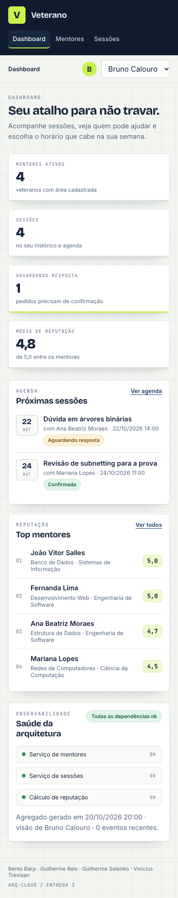
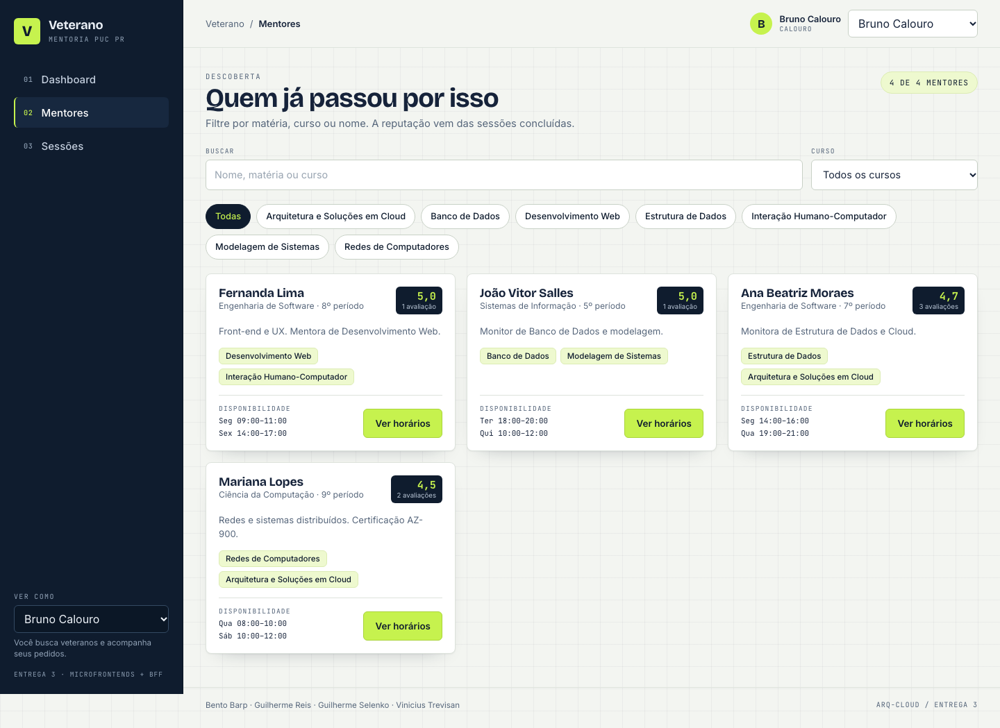
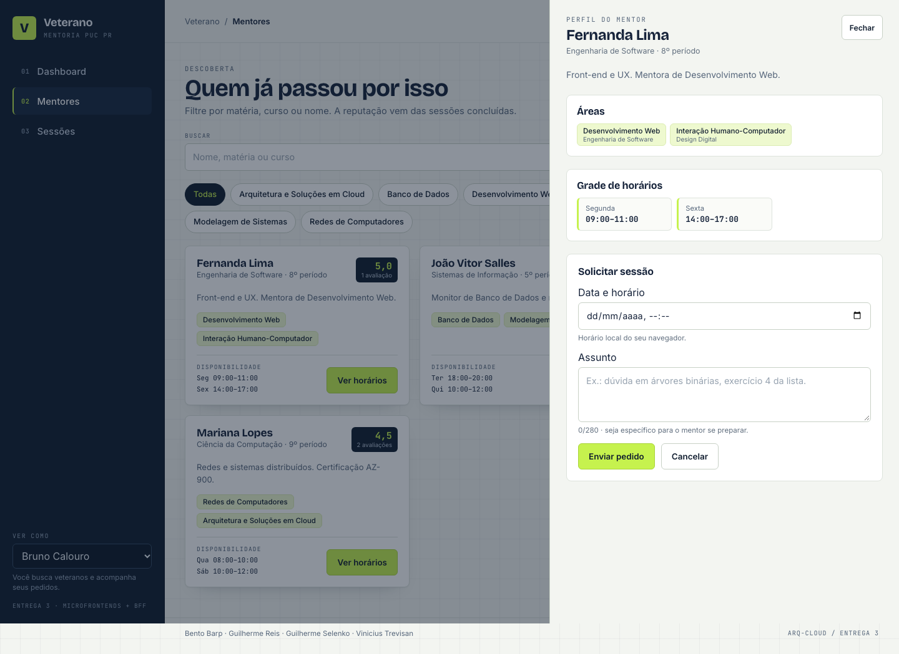
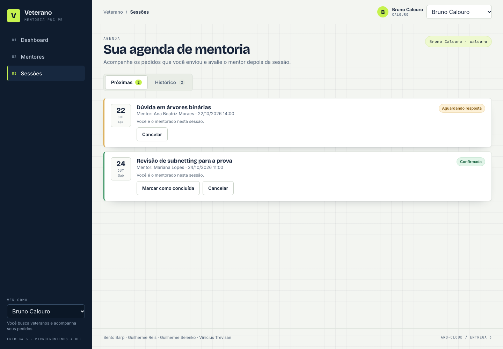
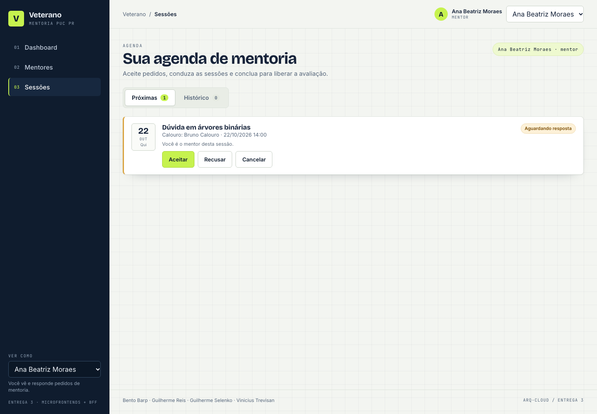
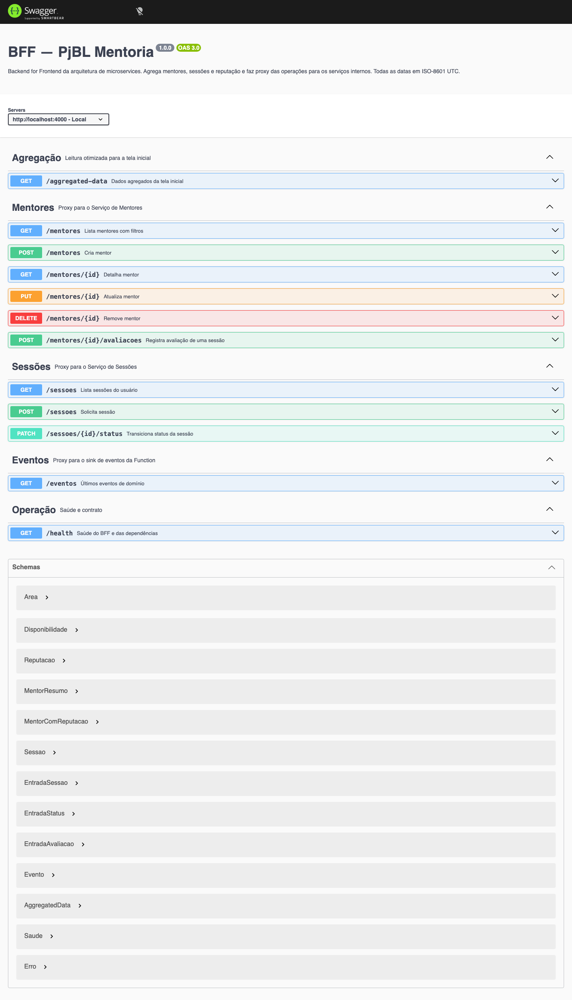
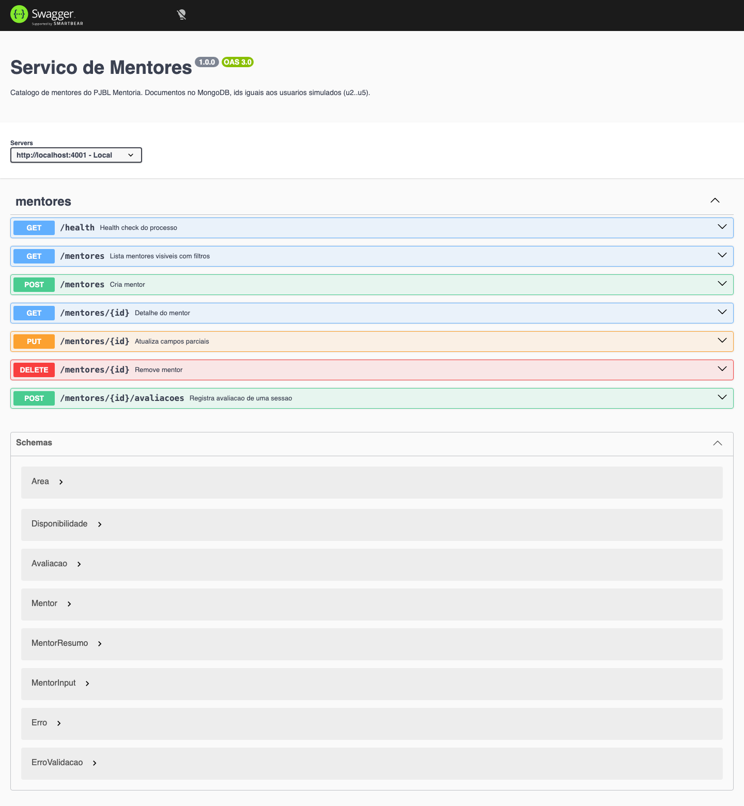
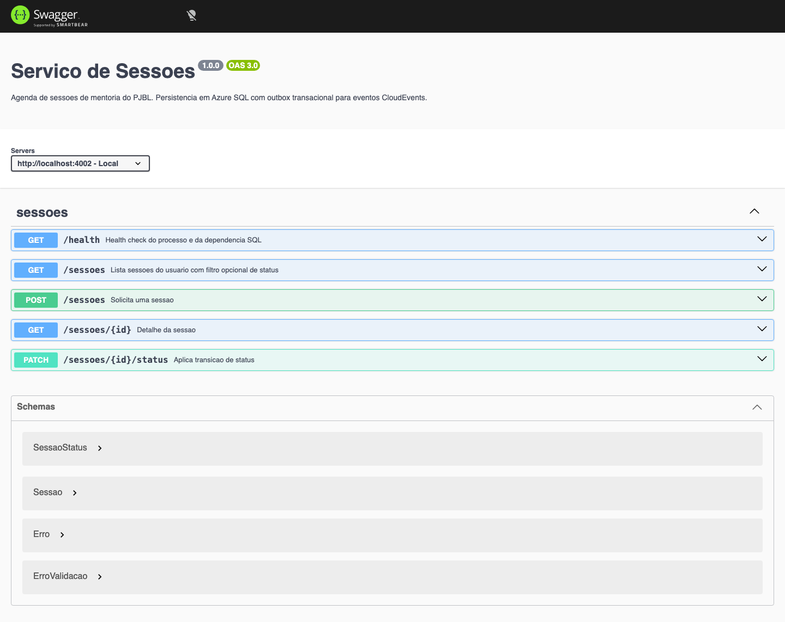
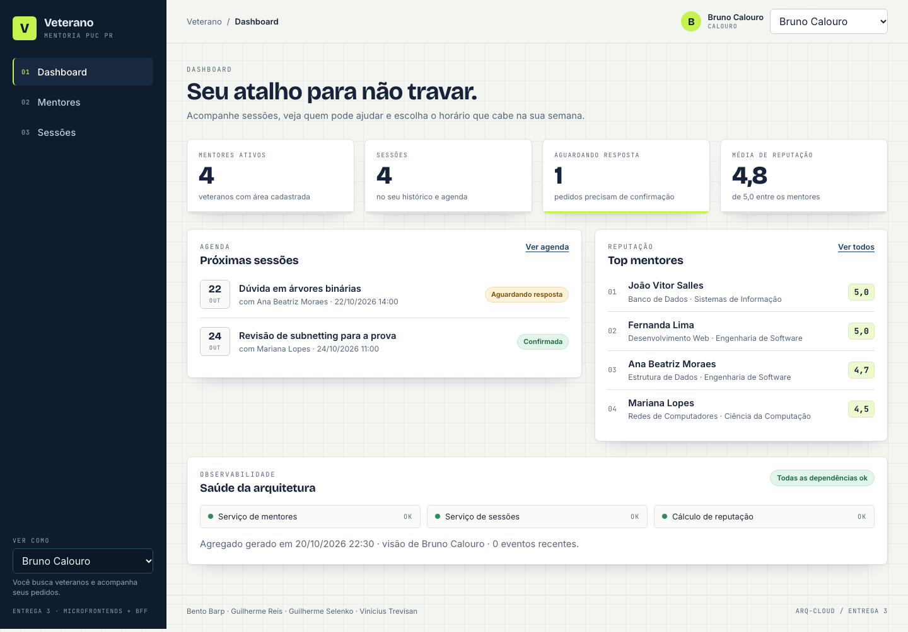

# 1. Introdução e metas

O **Veterano.** conecta calouros a veteranos para sessões de mentoria acadêmica. O calouro
busca mentores, solicita uma sessão e avalia depois; o veterano publica áreas e horários e
aceita ou recusa solicitações. Um mesmo usuário pode ser mentor e mentorado.

Esta entrega implementa a **arquitetura distribuída** do PJBL: microfrontends, BFF,
dois microsserviços com bancos diferentes, uma Azure Function e um API Gateway. O código
roda completo em `docker compose` e as mesmas imagens são publicadas no Docker Hub.

## 1.1 Requisitos funcionais cobertos

| ID | Requisito | Onde está |
|---|---|---|
| RF1 | Cadastro/login | fora do recorte desta entrega (identidade simulada por `X-Usuario-Id`) |
| RF2 | Perfil mentor/mentorado | documento de mentor no Serviço de Mentores |
| RF3 | Áreas/matérias do mentor | `areas[]` no Serviço de Mentores |
| RF4 | Disponibilidade | `disponibilidades[]` no Serviço de Mentores |
| RF5 | Busca com filtros | `GET /mentores` + MFE Descoberta |
| RF6 | Solicitar sessão | `POST /sessoes` + formulário no MFE Descoberta |
| RF7 | Aceitar/recusar | `PATCH /sessoes/:id/status` + MFE Agenda |
| RF8 | Notificação | evento de domínio no outbox → sink da Function (in-app no alvo) |
| RF9 | Ver sessões | `GET /sessoes` + MFE Agenda |
| RF10 | Avaliar mentor | `POST /mentores/:id/avaliacoes` + MFE Agenda |
| RF11 | Reputação | Azure Function `POST /api/reputacao` |
| RF12 | Concluir/cancelar | máquina de estados do Serviço de Sessões |

## 1.2 Metas de qualidade

| Prioridade | Meta | Critério verificável |
|---|---|---|
| 1 | Manutenibilidade | cada caso de uso é um arquivo; teste de arquitetura impede dependência invertida |
| 2 | Disponibilidade parcial | BFF responde 200 com `parcial: true` quando um serviço cai |
| 3 | Deploy independente | 7 imagens Docker; trocar um serviço não reconstrói os demais |
| 4 | Usabilidade | uma chamada por tela; estados de carregando, vazio e erro |
| 5 | Custo | tudo executável em Docker local; em nuvem, SKUs gratuitas/consumption |

## 1.3 Stakeholders

Calouro (mentorado), veterano (mentor), coordenação, equipe de 4 alunos e o professor da
disciplina, que avalia arquitetura, código, testes e documentação.

# 2. Restrições

| Tipo | Restrição | Consequência |
|---|---|---|
| Organizacional | 4 alunos, um semestre | escopo cortado em identidade real e e-mail |
| Acadêmica | microfrontend, BFF, 2 microsserviços com bancos distintos, Function e gateway | todos aparecem implementados, não só desenhados |
| Técnica | MongoDB para o Serviço de Mentores | documento único com áreas, horários e avaliações embutidos |
| Técnica | SQL para o Serviço de Sessões | transação e concorrência otimista na mudança de estado |
| Técnica | Azure Functions para a Function | Node v4 programming model, HTTP trigger |
| Operacional | demo em vídeo com URLs públicas | imagens no Docker Hub + plano de deploy Azure documentado |
| Convenção | documentação em arc42, diagramas C4 em Mermaid | este documento e `diagramas/*.mmd` |

# 3. Contexto e escopo

## 3.1 Contexto de negócio

{{DIAGRAMA:c4-n1-contexto|Contexto (C4 nível 1) — usuários, sistema e e-mail.}}

## 3.2 Contexto técnico

O navegador baixa o shell e os dois remotes (Module Federation). Toda chamada de dados passa
pelo API Gateway, que encaminha ao BFF. O BFF agrega Serviço de Mentores (MongoDB), Serviço
de Sessões (Azure SQL) e Azure Function (reputação). O navegador nunca fala com um serviço
interno, e nenhum serviço lê o banco de outro.

| Parceiro | Protocolo | Observação |
|---|---|---|
| Navegador → Gateway | HTTPS/JSON | header `X-Usuario-Id` (identidade simulada) |
| Gateway → BFF | HTTP interno | remove `/api`, aplica CORS e rate limit |
| BFF → serviços | HTTP/JSON | timeout de 3 s, agregação tolerante a falha |
| Serviço de Mentores → MongoDB | wire protocol/TLS | driver oficial, conexão cacheada |
| Serviço de Sessões → Azure SQL | TDS 1433 | `mssql`, transação + `rowversion` |
| Serviço de Sessões → Function | HTTP | eventos do outbox, pelo menos uma vez |

# 4. Estratégia de solução

## 4.1 Estilos arquiteturais

| Estilo | Onde aparece | Situação |
|---|---|---|
| Microfrontend | shell + MFE Descoberta + MFE Agenda, Module Federation | implementado |
| BFF | `bff/`, um endpoint agregado por tela | implementado |
| Microsserviços | Serviço de Mentores e Serviço de Sessões, deploy e banco próprios | implementado |
| Database per Service | MongoDB e Azure SQL; nenhum acesso cruzado | implementado |
| API Gateway | Kong DB-less local; APIM Consumption como alvo | implementado (local) |
| Serverless | Azure Function HTTP trigger; Function App no alvo | implementado |
| Event-Driven | outbox transacional + relay + sink idempotente | implementado (sink simplificado) |
| Clean Architecture | `domain → ports ← infrastructure`, `features` no centro | implementado |
| Vertical Slice | um arquivo por caso de uso em `features/` | implementado |

## 4.2 Decisões-chave

| Decisão | Escolha | Por quê |
|---|---|---|
| Banco por serviço | Mongo para perfil, SQL para sessão | documento é lido inteiro; sessão exige transação |
| Reputação | calculada pela Function | tira cálculo do banco e demonstra serverless com contrato HTTP |
| Falha de dependência | resposta parcial no BFF | uma tela não deve cair porque um serviço caiu |
| Comunicação assíncrona | outbox + relay | evita perder evento sem transação distribuída |
| Gateway | Kong local / APIM no alvo | mesmo papel: CORS, rate limit, roteamento e borda única |
| Identidade | header simulado | autenticação real não é requisito desta entrega; dívida registrada |
| Microfrontend | Module Federation | deploy independente por área, sem iframe |

## 4.3 Software Architecture Canvas

| Bloco | Conteúdo |
|---|---|
| **Contexto e problema** | calouro sem canal estruturado; veterano sem onde se oferecer; encontro invisível para a coordenação |
| **Objetivos de negócio** | reduzir evasão nos primeiros períodos; dar visibilidade a quem ajuda; tornar a mentoria mensurável |
| **Usuários** | calouro (primário), veterano (oferta), coordenação (moderação), equipe de 4 alunos |
| **Requisitos-chave** | busca com filtros; solicitar/aceitar; notificar por evento; avaliar e calcular reputação |
| **Atributos de qualidade** | manutenibilidade por fatia; deploy independente; falha isolada; custo ocioso baixo |
| **Restrições** | Azure/Docker, crédito de estudante, repositório público, arc42/C4 |
| **Estilos** | microfrontend, BFF, microsserviços, DB per service, EDA, gateway, Clean + Vertical Slice |
| **Princípios** | dependências apontam para o domínio; um caso de uso por fatia; nenhum serviço lê banco alheio; escrita entre serviços é evento |
| **Componentes** | shell + 2 MFEs, gateway, BFF, 2 serviços, Function, 3 bancos/emuladores |
| **Tecnologias** | React 18, Vite, TypeScript, Express, MongoDB, SQL Server 2022, Functions v4, Kong, Docker |
| **Riscos** | complexidade distribuída para 4 pessoas; cold start em cadeia; consistência eventual; credenciais de nuvem |
| **Métricas de sucesso** | fluxo completo em até 3 cliques por etapa; `aggregated-data` em 200 mesmo com 1 serviço fora; build e testes verdes; imagens publicadas |

# 5. Visão de blocos de construção

## 5.1 Nível 1 — contêineres (C4 nível 2)

{{DIAGRAMA:c4-n2-conteineres|Contêineres — microfrontends, gateway, BFF, serviços, Function e bancos.}}

| Contêiner | Tecnologia | Responsabilidade |
|---|---|---|
| Shell | React 18, Vite, nginx | layout, rotas, usuário, carga dos remotes |
| MFE Descoberta | React remote | busca, perfil, solicitação de sessão |
| MFE Agenda | React remote | listar sessões, aceitar/recusar/concluir/cancelar, avaliar |
| API Gateway | Kong 3.7 DB-less | rota `/api`, CORS, rate limit, `X-Gateway` |
| BFF | Node 22 + Express | `GET /aggregated-data` e proxies |
| Serviço de Mentores | Node 22 + Express + MongoDB | perfil, áreas, horários, avaliações |
| Serviço de Sessões | Node 22 + Express + Azure SQL | máquina de estados e outbox |
| Azure Function | Functions v4, HTTP trigger | reputação e sink de eventos |

## 5.2 Nível 2 — componentes (C4 nível 3)

### 5.2.1 Microfrontends

{{DIAGRAMA:c4-n3-mfe|Componentes dos microfrontends e contrato de composição.}}

O shell é dono das rotas e do usuário atual. Os remotes não se importam entre si: conversam
por URL e por `CustomEvent` (`veterano:sessoes-atualizadas`). React é `shared` singleton para
não carregar duas cópias. Falha ao baixar um remote é contida por `ErrorBoundary`.

### 5.2.2 API Gateway e BFF

{{DIAGRAMA:c4-n3-bff|Componentes do BFF; o gateway fica na borda.}}

O BFF não tem banco e não contém regra de negócio. `GetAggregatedData` chama os três
dependentes em paralelo com timeout de 3 s, usa `Promise.allSettled` e devolve `parcial` e
`falhas`. O gateway concentra CORS, limite de 120 req/min por IP e o carimbo `X-Gateway`.

### 5.2.3 Serviço de Mentores

{{DIAGRAMA:c4-n3-mentores|Componentes e fatias do Serviço de Mentores.}}

Fatias: `createMentor`, `listMentores`, `getMentor`, `updateMentor`, `deleteMentor`,
`addAvaliacao`. O domínio é puro e concentra validação, normalização de busca, campos
alterados e inclusão de avaliação. O adaptador Mongo e o adaptador em memória implementam a
mesma porta `MentorRepository`; o segundo permite rodar e testar sem Docker.

### 5.2.4 Serviço de Sessões

{{DIAGRAMA:c4-n3-sessoes|Componentes, máquina de estados e outbox do Serviço de Sessões.}}

A transição de estado acontece em uma transação: `UPDATE ... WHERE id AND status_esperado`
garante que dois cliques concorrentes não vençam; a linha de `OUTBOX_EVENTO` entra na mesma
transação. Um relay a cada 2 s publica os pendentes e marca `publicado_em`.

### 5.2.5 Regra de dependência (C4 nível 4)

```
mentores-service/src/            sessoes-service/src/              bff/src/
├── domain/    puro              ├── domain/    máquina de estados ├── domain/    tipos
├── ports/     contratos         ├── ports/     contratos           ├── application/
├── features/  uma fatia cada    ├── features/  uma fatia cada      │   ├── ports/
├── infrastructure/              ├── infrastructure/                │   └── use-cases/
│   ├── mongo/                   │   ├── sql/                       ├── infrastructure/
│   └── memory/                  │   ├── outbox/                    │   └── clients/
└── http/      entrada           │   └── memory/                    └── http/
                                 └── http/
```

O teste de arquitetura (`npm run test:arch`) falha se `domain` importar infraestrutura,
se `features` importar Express/driver ou se `ports` importar `infrastructure`.

# 6. Visão de runtime

## 6.1 Agregação de tela

{{DIAGRAMA:sequencia-agregacao|Sequência de GET /aggregated-data com agregação tolerante a falha.}}

## 6.2 Solicitar e aceitar sessão

1. Calouro escolhe mentor e horário no MFE Descoberta; `POST /api/sessoes` chega ao BFF e ao
   Serviço de Sessões.
2. O serviço valida (participantes diferentes, data futura, assunto) e grava `SOLICITADA` +
   evento `SessaoSolicitada` no outbox.
3. O relay publica o evento na Function; o MFE Agenda recarrega ao receber o evento de UI.
4. Mentor abre o MFE Agenda e aceita: `PATCH /api/sessoes/:id/status` com `{acao:"aceitar"}`.
   Se o ator não for o mentor → 403; se o estado não for `SOLICITADA` → 409.

## 6.3 Ciclo de vida da sessão

{{DIAGRAMA:estados-sessao|Máquina de estados da sessão.}}

## 6.4 Avaliação e reputação

Somente o mentorado avalia, somente em `CONCLUIDA`, e uma vez por sessão. A avaliação é
gravada no documento do mentor com `sessaoId` único (409 em duplicidade). A média não é
persistida: a Function calcula `{media, total, distribuicao, selo}` a partir das notas, e o
BFF enriquece a lista em uma chamada por mentor.

# 7. Visão de implantação

{{DIAGRAMA:implantacao|Implantação local (Docker Compose) e alvo Azure.}}

## 7.1 Portas locais

| URL | O que é |
|---|---|
| http://localhost:3000 | shell |
| http://localhost:3001 | MFE Descoberta (remoteEntry em `/assets/remoteEntry.js`) |
| http://localhost:3002 | MFE Agenda |
| http://localhost:8080/api | API Gateway (Kong) |
| http://localhost:8001 | Kong Admin API |
| http://localhost:4000/docs | Swagger do BFF |
| http://localhost:4001/docs | Swagger do Serviço de Mentores |
| http://localhost:4002/docs | Swagger do Serviço de Sessões |
| http://localhost:7071/api/health | Azure Function |

## 7.2 Imagens Docker Hub

| Imagem | Conteúdo |
|---|---|
| `vinitrevisan/veterano-bff:v1` | BFF |
| `vinitrevisan/veterano-mentores:v1` | Serviço de Mentores |
| `vinitrevisan/veterano-sessoes:v1` | Serviço de Sessões |
| `vinitrevisan/veterano-shell:v1` | Shell |
| `vinitrevisan/veterano-mfe-descoberta:v1` | MFE Descoberta |
| `vinitrevisan/veterano-mfe-agenda:v1` | MFE Agenda |
| `vinitrevisan/veterano-function:v1` | Azure Function (opcional em Container Apps) |

Publicação: `DOCKERHUB_USER=vinitrevisan npm run publish:dockerhub`.

## 7.3 Implantação publicada (Azure)

Executada em 20/10/2026, resource group `rg-veterano-entrega3`, região `centralus`.

| Local | Azure publicado |
|---|---|
| shell + remotes (nginx) | 3 Static Web Apps (Free) |
| Kong | Container App `kong` com `gateway/kong.cloud.yml` (APIM documentado como alternativa) |
| BFF e serviços | 4 Container Apps (BFF, Mentores, Sessões, Kong) com imagens no ACR |
| Azure Function | Function App Linux Consumption, Node 22 |
| MongoDB | Cosmos DB Mongo API (free tier) |
| SQL Server 2022 | Azure SQL Database Basic |
| outbox → Function | HTTP direto; Service Bus é o alvo de produção |

| URL | O quê |
|---|---|
| https://proud-sky-03f0d2710.6.azurestaticapps.net | shell |
| https://jolly-mushroom-0ab769910.1.azurestaticapps.net | MFE Descoberta |
| https://ashy-pond-00cc75510.3.azurestaticapps.net | MFE Agenda |
| https://kong.whiterock-0aaa2038.centralus.azurecontainerapps.io/api | gateway |
| https://bff.whiterock-0aaa2038.centralus.azurecontainerapps.io/docs | Swagger do BFF |
| https://func-veterano-ce3bfe.azurewebsites.net/api/health | Function |

Desvios registrados: o ambiente Container Apps é *express* e não resolve nome curto entre
apps; por isso os serviços têm ingress externo e o BFF usa as URLs públicas. O Cosmos Mongo
expõe wire version 6, então o driver do Serviço de Mentores foi fixado em `mongodb@4.17.2`.

# 8. Conceitos transversais

## 8.1 Eventos

{{DIAGRAMA:eventos|Fluxo de eventos local e alvo.}}

Envelope no estilo CloudEvents (`id`, `type`, `source`, `time`, `data`). O `id` é a chave de
idempotência: a Function ignora um evento repetido. Em nuvem o mesmo envelope vai ao Service
Bus com `sessionId = sessaoId` para preservar a ordem dos eventos da mesma sessão.

## 8.2 Dados

| Banco | Entidades | Modelagem |
|---|---|---|
| MongoDB | `mentores` | documento único com `areas`, `disponibilidades`, `avaliacoes`; índice único em `id` |
| Azure SQL | `SESSAO`, `OUTBOX_EVENTO` | status + `rowversion`; outbox na mesma transação |
| Function | buffer em memória | apenas demonstração; alvo é Service Bus + Table Storage |

No ambiente publicado o MongoDB é o Cosmos DB Mongo API (wire version 6), o que exige o driver
`mongodb@4.17.2`; localmente roda MongoDB 7. O schema SQL é criado no boot com retry e o
`CREATE DATABASE` só acontece quando o catálogo ainda não existe.

Referências entre serviços são identificadores, nunca chaves estrangeiras.

## 8.3 Segurança

- Gateway é a única porta de entrada do navegador.
- Serviços internos deveriam ser fechados; no ambiente Azure atual eles têm ingress externo por
  limitação do ambiente *express* (dívida registrada na seção 11).
- Header `X-Usuario-Id` simula identidade; **não é autenticação** e está registrado como dívida.
- Segredos em `.env`, fora do repositório; `.env.example` versionado.
- Erros 500 não devolvem mensagem do driver nem stack.

## 8.4 Validação e erros

| Código | Quando |
|---|---|
| 400 | JSON malformado ou id inválido |
| 403 | ator não participa ou não é mentor na ação |
| 404 | recurso inexistente |
| 409 | transição inválida, avaliação duplicada ou concorrência |
| 422 | regra de validação (nota fora de 1..5, data passada, campos) |
| 502 | proxy do BFF não alcançou o serviço |
| 200 + `parcial` | agregação com dependência fora |

## 8.5 Observabilidade

Cada serviço loga operação, status e duração sem dado pessoal. `/health` existe em todos os
contêineres e é usado pelos `healthcheck` do Compose; o `/health` do BFF informa o estado dos
três dependentes. Em nuvem, Application Insights recebe as mesmas informações.

## 8.6 Contratos entre microfrontends

Rotas pertencem ao shell; remotes recebem apenas o necessário por props e leem o usuário do
`localStorage`. A comunicação indireta usa `CustomEvent`. Tokens CSS ficam no shell.

## 8.7 Testes

| Tipo | Onde | Ferramenta |
|---|---|---|
| Unitário de domínio | `*/test/*.test.ts` | Vitest |
| Unitário de caso de uso | idem, com repositório fake | Vitest |
| Arquitetura | `*/test:arch` | dependency-cruiser |
| Smoke de integração | `scripts/smoke.sh` | curl no gateway |
| Manual | roteiro da seção 12 | navegador |

## 8.8 Uso de IA generativa

O código e esta documentação foram produzidos com assistência de agentes de IA e revisados
pela equipe: contratos conferidos contra o PRD, build/testes executados e fluxo navegado no
ambiente Docker.

# 9. Decisões de arquitetura (ADRs)

**ADR-01 — Microfrontends com Module Federation.** Contexto: 4 alunos mexem no front ao mesmo
tempo. Decisão: shell + remotes compostos no navegador. Consequência: deploy independente;
custo de compatibilidade de React e fallback obrigatório.

**ADR-02 — Kong local, APIM no alvo.** Contexto: CORS/rate limit/rota se repetiriam.
Decisão: gateway dedicado. Consequência: uma porta de entrada e um salto extra; o alvo troca
Kong por APIM sem tocar no BFF.

**ADR-03 — BFF sem regra de negócio.** Contexto: telas precisam de dados de três origens.
Decisão: agregação e adaptação de formato no BFF. Consequência: uma chamada por tela; risco
de virar gargalo se acumular regra — proibido por convenção.

**ADR-04 — Banco poliglota por serviço.** Contexto: perfil é documento, sessão é transação.
Decisão: MongoDB e Azure SQL, sem acesso cruzado. Consequência: sem junção; leitura cruzada
via BFF; duas tecnologias para operar.

**ADR-05 — Reputação na Function.** Contexto: cálculo simples, precisa de exemplo de
serverless com contrato próprio. Decisão: HTTP trigger puro e testável. Consequência: uma
chamada extra por mentor na agregação, mitigada por paralelismo e limite de concorrência.

**ADR-06 — Outbox em vez de transação distribuída.** Contexto: gravar sessão e publicar
evento. Decisão: outbox na mesma transação + relay. Consequência: pelo menos uma vez;
consumidor precisa ser idempotente.

# 10. Requisitos de qualidade

| Cenário | Estímulo | Resposta esperada |
|---|---|---|
| Disponibilidade parcial | Serviço de Sessões fora do ar | `aggregated-data` em 200, `parcial: true`, `falhas:["sessoes"]` |
| Desempenho | 50 buscas simultâneas | gateway limita a 120 req/min por IP; respostas em < 2 s no P95 local |
| Consistência | dois cliques em “aceitar” | apenas uma transição vence; a outra recebe 409 |
| Segurança de recurso | calouro tenta aceitar a própria solicitação | 403 |
| Integridade | avaliação duplicada da mesma sessão | 409 |
| Manutenibilidade | trocar Mongo por memória | apenas a composição muda; domínio e fatias intactos |

# 11. Riscos e dívidas técnicas

| Risco / dívida | Impacto | Mitigação |
|---|---|---|
| Identidade simulada por header | qualquer cliente pode se passar por outro usuário | documentado; alvo é Entra External ID + JWT no gateway |
| Sink de eventos em memória | eventos não sobrevivem a restart | outbox garante reenvio; alvo é Service Bus |
| Sem e-mail real (RF8) | notificação apenas registrada | Interface de e-mail prevista; alvo ACS |
| Cold start em cadeia | primeira requisição lenta em nuvem | imagens leves e, no alvo, instância mínima no BFF |
| Ambiente Container Apps *express* sem DNS curto | BFF e Kong não resolvem `mentores-service`; serviços ficaram públicos | usar ambiente com workload profiles/VNet ou ingress interno com FQDN; registrar no vídeo |
| Cosmos DB Mongo API 3.6 | driver moderno incompatível | driver `mongodb@4.17.2`; Atlas M0 no alvo |
| Banco SQL em emulador | diferenças em relação ao Azure SQL | T-SQL padrão e migração por DDL simples |
| Duplicação do cliente HTTP nos MFEs | manutenção em três lugares | pacote compartilhado é evolução prevista |
| Sem CI/CD nesta entrega | publicação manual | scripts `publish:dockerhub` e `smoke` versionados |

# 12. Roteiro de demonstração

1. `cp .env.example .env && docker compose up --build -d`; aguardar todos os healthchecks.
2. Abrir http://localhost:3000 com o usuário **Bruno Calouro**.
3. Dashboard mostra KPIs, próximas sessões e top mentores vindos de `/aggregated-data`.
4. Ir em **Mentores**, filtrar por matéria, abrir um perfil e solicitar sessão em um horário.
5. Trocar para **Ana (mentora)** e abrir **Sessões**: aceitar a solicitação.
6. Trocar de volta para Bruno, concluir a sessão e avaliar com nota e comentário.
7. Voltar aos mentores: a reputação atualizada aparece no card.
8. Abrir Swagger do BFF, dos dois serviços e a Admin API do Kong.
9. Derrubar `sessoes-service` e recarregar o dashboard: resposta parcial, sem tela em branco.

---

# Anexo A — Links da entrega

| Item | Link |
|---|---|
| Repositório (monorepo, branch `entrega-3-microservices`) | https://github.com/ViniMTrevisan/pjbl-mentoria-cloud/tree/entrega-3-microservices |
| Shell | https://github.com/ViniMTrevisan/pjbl-mentoria-cloud/tree/entrega-3-microservices/microfrontend/shell |
| MFE Descoberta | https://github.com/ViniMTrevisan/pjbl-mentoria-cloud/tree/entrega-3-microservices/microfrontend/mfe-descoberta |
| MFE Agenda | https://github.com/ViniMTrevisan/pjbl-mentoria-cloud/tree/entrega-3-microservices/microfrontend/mfe-agenda |
| BFF | https://github.com/ViniMTrevisan/pjbl-mentoria-cloud/tree/entrega-3-microservices/bff |
| Serviço de Mentores | https://github.com/ViniMTrevisan/pjbl-mentoria-cloud/tree/entrega-3-microservices/mentores-service |
| Serviço de Sessões | https://github.com/ViniMTrevisan/pjbl-mentoria-cloud/tree/entrega-3-microservices/sessoes-service |
| Azure Function | https://github.com/ViniMTrevisan/pjbl-mentoria-cloud/tree/entrega-3-microservices/azure-function |
| API Gateway (configuração) | https://github.com/ViniMTrevisan/pjbl-mentoria-cloud/tree/entrega-3-microservices/gateway |
| Docker Hub | https://hub.docker.com/u/vinitrevisan |
| Vídeo no YouTube | https://youtu.be/SUBSTITUIR-PELO-ID-DO-VIDEO |
| Ambiente Azure (shell) | https://proud-sky-03f0d2710.6.azurestaticapps.net |
| API Gateway público | https://kong.whiterock-0aaa2038.centralus.azurecontainerapps.io/api/aggregated-data?usuarioId=u1 |

# Anexo B — Swagger e endpoints

| Serviço | Swagger local | OpenAPI |
|---|---|---|
| BFF | http://localhost:4000/docs | http://localhost:4000/openapi.json |
| Mentores | http://localhost:4001/docs | http://localhost:4001/openapi.json |
| Sessões | http://localhost:4002/docs | http://localhost:4002/openapi.json |
| Gateway | http://localhost:8001/status | configuração em `gateway/kong.yml` |
| Function | http://localhost:7071/api/health | contrato em `docs/entrega3/API-CONTRACTS.md` |

# Anexo C — Evidências (prints)

Capturas feitas na aplicação real em Docker, em 20/10/2026.

| Evidência | Arquivo |
|---|---|
| Dashboard agregado | `prints/01-dashboard.png` |
| Dashboard em 390 px | `prints/01b-dashboard-mobile.png` |
| Busca de mentores | `prints/02-descoberta.png` |
| Perfil e solicitação de sessão | `prints/02b-perfil-mentor.png` |
| Sessões do calouro | `prints/03-agenda.png` |
| Sessões do mentor (aceite/recusa) | `prints/03b-agenda-mentor.png` |
| Swagger do BFF | `prints/04-swagger-bff.png` |
| Swagger de Mentores | `prints/05-swagger-mentores.png` |
| Swagger de Sessões | `prints/06-swagger-sessoes.png` |
| API Gateway + Azure Function | `prints/07-gateway-e-function.png` |

### C.1 Microfrontend — dashboard

{width=100%}

{width=26%}

### C.2 Microfrontend — descoberta e solicitação

{width=100%}

{width=100%}

### C.3 Microfrontend — agenda

{width=100%}

{width=100%}

### C.4 Swagger

{width=100%}

{width=100%}

{width=100%}

### C.5 API Gateway e Azure Function

{width=100%}

### C.6 Ambiente publicado na Azure

{width=100%}

{width=100%}

{width=100%}

# Anexo D — Como rodar e testar

```bash
cp .env.example .env
docker compose up --build -d     # 11 contêineres
npm run smoke                    # gateway + agregação + CRUD
npm run test:all                 # unitários + arquitetura
docker compose down              # mantém volumes
docker compose down -v           # limpa bancos
```

Sem Docker, cada serviço sobe em modo memória:

```bash
cd mentores-service && npm install && npm run dev       # :4001
cd sessoes-service  && npm install && npm run dev       # :4002
cd bff              && npm install && npm run dev       # :4000
cd azure-function   && npm install && npm run build && npm start   # necessário Functions Core Tools
```

# Anexo E — Glossário

| Termo | Significado |
|---|---|
| BFF | Backend for Frontend: agrega serviços no formato da tela |
| MFE | Microfrontend: parte da UI publicada de forma independente |
| Outbox | Tabela com eventos gravados na mesma transação do dado |
| Database per Service | cada serviço é dono exclusivo do seu banco |
| Vertical Slice | um caso de uso por arquivo, atravessando as camadas |
| Selo de reputação | classificação derivada da média e do volume de avaliações |
